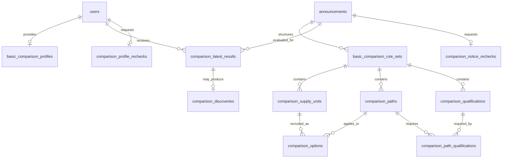

# 신청자격 판정의 데이터 모델과 갱신 경계

공고에서 추출한 조건, 사용자가 입력한 정보, 사용자별 판정 결과를 연결하는 백엔드 설계다.
공고의 실제 모집 선택지 중 하나라도 지원 가능하면 공고는 지원 가능이다. 확인된 미충족,
수집 항목의 미입력, 미수집 필수 자격, 미수집 신청 제한 안내는 서로 다른 의미로 유지한다.

기능 통합 대상은 `feat/562-basic-comparison-integration`이다. 프론트·공고 수집·기존 공통
데이터는 보존한다. `develop`에서 최신 변경을 가져오지만 이 작업을 `develop`에 병합하지 않는다.

## 저장 경계와 선택 이유

공고 구조화 내용은 원문 근거, 조건식, 공유물량, 묶음 신청, 임대조건과 일정을 함께 검증하는
하나의 작성 단위다. 기존 `basic_comparison_rule_sets.content`의 타입이 정해진 JSONB를
원본으로 유지하고, 모집 단위·경로·선택지·정확한 필수 자격은 관계형 행으로 함께 저장한다.
관계형 행은 같은 트랜잭션에서만 다시 만들며 외부에서 따로 수정하는 API를 두지 않는다.

이렇게 하면 조건식의 AND/OR와 공고별 예외, 보증금·월세 조합 등의 관계를 잃지 않으면서
선택지·지역·탐색 분류에 대한 조회와 FK 검증을 할 수 있다. 조건식을 현재 사용자 입력에
맞춰 잘라 저장하지 않는다. 미수집 법정 자격도 이름·근거·원문 조건·탐색 분류를 저장한다.
새 테이블은 판정 가능한 조건만 모은 공고 축약본이 아니다.

사용자 입력은 회원별 현재 JSONB 한 벌로 저장한다. 값과 상태를 같이 검증해 교체하므로
0·없음·미입력이 섞이지 않는다. 현재 사용자 입력과 무관한 법정 자격을 프로필에 생성하지
않는다. 판정은 공고 내용과 프로필을 입력으로 받는 도메인 로직이 담당한다.

판정 결과는 회원·공고마다 최신 완료 결과 한 벌만 저장한다. 원문 문서·전체 임대조건 같은
공고 공통 데이터를 사용자 수만큼 복제하지 않고, 결과에는 조건 판독·선택지 결과·근거 ID를
저장한다. 현재 공고 내용은 조회 시 연결한다. 공고 기준이 바뀌면 이전 결과의 근거를 현재
원문 근거인 것처럼 연결하지 않는다.

## 관계

공고·프로필 저장은 앞 PR에서, 최신 결과·복구 작업·새 지원 가능 발견은 후속 PR에서
연결한다. 아래는 전체 계약이며 각 테이블의 실제 DDL과 실행 여부는 해당 마이그레이션과
코드를 기준으로 확인한다.

## 공고 구조화 테이블

### `basic_comparison_rule_sets` — 작성 단위와 현재 공개본

| 컬럼 | 타입·제약 | 의미 |
|---|---|---|
| `id` | bigint identity PK | 작성 단위의 고유 ID. 현재 공개본의 판정 기준 식별에도 사용 |
| `announcement_id` | bigint FK → announcements, 삭제 연쇄 | 원문 공고 게시물 |
| `status` | DRAFT / PUBLISHED | 공고당 각 상태 한 개, UNIQUE(announcement_id, status) |
| `revision` | bigint > 0 | 같은 초안의 수정 식별값. 기대 revision 불일치는 충돌 |
| `version` | bigint ≥ 0 | 공개 순서. 초안은 0, 공개본은 양수 |
| `schema_version` | integer, 지원하는 계약 버전 | 기존 2와 확장 3을 구분. 새 작성은 3 |
| `content` | jsonb object NOT NULL | 아래의 전체 구조화 내용. 임의 JSON을 허용하는 계약이 아님 |
| `updated_at`, `published_at` | timestamptz, 공개 시각은 공개 상태에서 필수 | 저장·공개 시점 |

공개 시 초안 검증 후 기존 공개본을 교체한다. 실패하면 이전 공개본과 관계형 행을 함께
보존한다. `version`만으로 현재성을 판단하지 않고 재사용되지 않는 `id`도 비교한다.
기존 Flyway 파일은 수정하지 않으며 새 마이그레이션으로 제약과 테이블을 추가한다.

`content`의 필수 구조:

| 항목 | 데이터와 관계 |
|---|---|
| metadata | 공고 기준일, 개인/기관 신청, 작성 범위, 검토 상태와 분류 근거 |
| documents / evidences | 문서 ID·파일명·URL·해시·쪽수와 근거의 문서/쪽/위치. 같은 작성 단위 안에서 참조 |
| commonChecks | 공고 전체 실제 신청 경로에 공통으로 적용되는 조건. 일부 단위 조건을 여기에 올리지 않음 |
| supplyUnits | 신청 단위 ID·명칭·지역 코드와 소속 실제 단지/주택형 목록. 묶음 관계 유지 |
| paths | 신청 경로 ID·사용자 표시명·조건식·필수 자격 ID 목록 |
| options | 신청 단위 × 경로의 실제 모집 여부. 같은 조합은 한 번만 존재 |
| qualifications | 정확한 자격명·법적 근거·요구 조건 원문·넓은 탐색 분류·근거 ID |
| guidances | 적용 범위가 있는 미수집 신청 제한·절차·기타 직접 확인 안내. 필수 자격과 혼동하지 않음 |
| quantities | 물량 종류·값·함께 공유하는 신청 단위/선택지 ID 목록. 여러 경로가 공유해도 한 물량 |
| rentOffers / schedules | 적용 대상 설명, 금액 조합·전환 조건, 시간·장소·URL과 신청 단위/선택지·원문 근거 |

물량·임대조건·일정의 `optionIds`는 같은 단위의 특정 경로만 대상으로 삼을 때 쓴다.
`supplyUnitIds`의 모든 선택지와 `optionIds`의 합집합이 적용 범위이며 물량은 ID당 한 번만 센다.
원문에 없는 경로별 배분은 만들지 않는다.

조건은 항목명·검사 대상인 입력 코드·연산·기준값·적용 조건·근거를 갖는다. 조건의 역할은
원문대로 구조화한다. 순위·배점·임대료용 조건을 신청자격의 필수 조건으로 바꾸지 않는다.

### 관계형 공고 행

모든 행의 `rule_set_id`는 작성 단위 FK이며 삭제 시 연쇄 삭제한다. 공개본 삭제가
사용자 최신 완료 결과까지 삭제하지 않도록 결과의 판정 기준 ID에는 이 삭제 FK를 걸지 않는다.

| 테이블 | 컬럼 | 키·제약·이유 |
|---|---|---|
| `comparison_supply_units` | rule_set_id bigint, unit_key varchar(100), label varchar(300), region_codes text[], housing_types jsonb | PK(rule_set_id, unit_key). 지역 배열 GIN 인덱스. 주택 목록은 배열이며 원문의 여러 단지·주택형 관계를 보존 |
| `comparison_paths` | rule_set_id bigint, path_key varchar(100), label varchar(300), kind varchar(30), checks jsonb | PK(rule_set_id, path_key). 조건 목록은 배열. APPLICATION은 실제 신청 경로, 기존 GENERAL·COMMON_ONLY는 이전 계약을 읽기 위한 구분 |
| `comparison_qualifications` | rule_set_id bigint, qualification_key varchar(100), exact_name varchar(300), legal_basis text, conditions_as_written text, categories text[], evidence_ids jsonb | PK(rule_set_id, qualification_key). 정확한 명칭·조건·근거 필수, categories GIN. 가족 형태와 법정 자격을 동일시하지 않음 |
| `comparison_path_qualifications` | rule_set_id bigint, path_key varchar(100), qualification_key varchar(100) | 세 컬럼 PK, 경로·자격 각각 같은 rule_set의 복합 FK. 여러 대안 자격은 원문에 맞는 별도 경로로 표현 |
| `comparison_options` | rule_set_id bigint, option_key varchar(100), unit_key varchar(100), path_key varchar(100), recruitment_status varchar(30) | PK(rule_set_id, option_key), UNIQUE(rule_set_id, unit_key, path_key), 같은 rule_set 단위·경로 FK |

모집 상태는 RECRUITING, UPCOMING, NOT_RECRUITING, CANCELLED, UNKNOWN으로 구분한다.
취소는 사용자 자격 미충족이 아니다. 지역을 확인하지 못한 단위는 빈 지역 배열로 남기며
다른 단위의 위치를 복사하거나 사용자의 거주지역으로 대체하지 않는다.

관계형 행에는 조건·원문 JSON을 재해석해 별도 규칙을 만들지 않는다. 저장 직전에 타입과
참조를 검증하고 원본과 동일한 값만 투영한다. 기존 저장 내용도 새 마이그레이션에서 투영해
이전 공개본이 검색 인덱스에서 빠지지 않게 한다. 알 수 없는 구조는 공개 검증을 통과하지 못한다.

## 사용자 입력 테이블

`basic_comparison_profiles`를 회원별 현재 프로필로 계속 사용한다.

| 컬럼 | 타입·제약 | 의미 |
|---|---|---|
| user_id | bigint PK/FK → users, 삭제 연쇄 | 인증된 회원. 요청에서 타인의 ID를 선택하지 않음 |
| version | bigint > 0 | 저장 때마다 증가. 기대 version과 다르면 409 |
| input_contract_version | integer | 입력 형식을 식별. 신규 공통 입력을 포함한 지원 버전으로 저장 |
| profile | jsonb object | familyDetailsState와 항목별 PROVIDED/UNKNOWN/NOT_APPLICABLE 및 값 |
| updated_at | timestamptz NOT NULL | 현재 입력의 저장 시각 |

기존 본인·가족 입력의 형식을 재사용하되 Q5의 현재 지역 거주기간(완료 개월 수)과
현재 거주 집 계약 종료일(날짜)을 추가한다. 입력 계약은 3이며 기존 2는 읽기 호환한다. 기간은 현재 집 거주기간이 아니며,
공고마다 과거 지역을 추가로 질문하지 않는다. 계약 종료일은 미래일도 유효하다.
기간 범위는 현재 거주지역 코드의 행정구역이며 0~1800 완료 개월 수다. 지역 변경 시 사용자가 함께 갱신한다.
계약 종료일이 없는 거주는 NOT_APPLICABLE로 표현하며, 모르면 UNKNOWN이다.
새 항목은 빈 값으로 둘 수 있고 해당 조건에 필요한 경우에만 입력 부족으로 표시한다.

본인·세대 합계는 입력 코드와 도움말로 구분한다. 소득 없음은 0, 미입력은 UNKNOWN이다.
가족 형태·검색 필터로 법정 필수 자격을 만들어 저장하지 않는다. 기존 사용자 입력에서
수집하지 않는 자격은 공고의 qualifications에 남는다. 프로필 전체 이력은 추가하지 않는다.

## 최신 결과와 재판정 테이블

이 절은 후속 PR의 구현 계약이다. 실제 DDL의 확정 컬럼·인덱스와 차이가 생기면 함께 갱신한다.

| 테이블 | 키와 핵심 컬럼 | 제약과 목적 |
|---|---|---|
| `comparison_latest_results` | PK(user_id, announcement_id), profile_version, rule_set_id, rule_set_revision, evaluator_version, status, result jsonb, evaluated_at | 사용자·공고 FK 삭제 연쇄. 한 쌍의 최신 완료 결과만 교체. rule_set_id는 판정 당시 식별값으로 보존하므로 이전 공개본 삭제에 연쇄되지 않음 |
| `comparison_profile_rechecks` | user_id PK/FK, requested_version, cursor_announcement_id, state, claim_token, lease_until, next_attempt_at, attempts, last_error_code, updated_at | 회원당 한 작업을 합쳐 저장. 입력 저장과 같은 트랜잭션에서 갱신. 오래된 lease/버전은 진행·완료를 덮어쓰지 못함 |
| `comparison_notice_rechecks` | announcement_id PK/FK, requested_generation, cursor_user_id, state, claim_token, lease_until, next_attempt_at, attempts, last_error_code, updated_at | 공고 변경당 회원을 작은 묶음으로 조회. 사용자×공고 전체에 대한 대기 행을 미리 생성하지 않음 |
| `comparison_discoveries` | PK(user_id, announcement_id), generation, profile_version, rule_set_id, option_ids jsonb, discovered_at, acknowledged_at | Q8 전후 비교·반복 방지에 필요한 현재 발견만 보존. 한 공고 평생 1회가 아님. 현재 입력·공고와 어긋난 발견은 노출·발송 대상으로 사용하지 않음 |

결과에는 원문의 전체 내용이나 과거 프로필을 넣지 않는다. 공통·경로 조건은 가능한 범위에서
한 번 판독하고 선택지는 해당 판독을 참조한다. 부하 검증에서는 활성 공고 수 × 사용자 수,
결과 평균 크기, 변경 빈도와 처리량을 함께 측정한다. 이 문서는 100만 명 성능의 실측 증거가 아니다.

### 갱신과 복구

현재 공고 기준은 정정 체인의 현재 게시물, 공개/취소 상태와 공개 rule set 식별값을 모두
포함하는 generation으로 식별한다. 공개뿐 아니라 정정 연결·취소·공개 철회도 generation과
공고 재판정 필요 사실을 같은 트랜잭션에서 남긴다. 기존 변경 경로의 연결 누락을 감지하는
대조 작업도 두며, 특정 사용자의 재입력이 있어야만 변경을 반영하는 구조를 피한다.

1. 프로필 저장은 현재 값·버전과 재판정 필요 사실을 원자적으로 저장한다. 저장 완료를 먼저 응답한다.
2. 작업자는 기한이 지난 미완료 작업 또는 처리 시각이 된 작업을 잠금으로 선점한다. 긴 평가 중에는 DB 잠금을 유지하지 않는다.
3. 저장한 입력·공고 기준으로 평가한 뒤 짧은 반영 트랜잭션에서 잠금/CAS로 현재 기준 확인과 결과·발견 저장을 원자화한다.
4. 기준이 다르면 결과·발견을 반영하지 않고 현재 기준의 작업을 남긴다. 늦게 끝난 작업이 최신 작업보다 우선하지 않는다.
5. 정상 완료 시 한 쌍의 결과를 교체한다. 이전 완료 결과와 비교해 새 지원 가능 발견의 최소 정보만 갱신한다.
6. 커서·완료 갱신은 요청 version/generation과 claim token이 모두 같을 때만 허용한다. 새 요청은 커서를 시작점으로 되돌린다. 결과 저장 실패 시 커서를 진전시키지 않는다.
7. 미시작·실패·lease 만료는 재선점할 수 있다. 재시도 간격에는 상한을 두되 필요 사실을 삭제하거나 사용자 재입력을 복구 조건으로 삼지 않는다.

공고 정정 시 영향받는 선택지를 새 기준으로 판정하고 이전 기준의 안내는 보류한다.
일부 취소는 해당 선택지에만 반영한다. 공고 전체 취소는 지원 가능 노출·대기 발송을 중단한다.
이전 결과가 보이면 정보 또는 공고 변경 전 결과임을 명시한다. 처리 중을 정보 부족이나
필수 자격 직접 확인으로 바꾸지 않는다.

## 검증과 전환

공고 저장은 D05의 일반입주자 경로, D11의 정확한 법정 자격, D01의 서로 다른 지역의
실제 모집 선택지를 포함한다. FK 교차 참조, 중복 선택지, 공개 실패 롤백, 기존 데이터
투영, 프로필 충돌, 오래된 작업·중단 복구를 실제 격리 PostgreSQL에서 검증한다.

기존 v2 경로를 소비하는 프론트 코드는 작업 시작 시 확인되지 않았다. 프론트팀이 연결할
새 판정 API와 결과 형식은 구현 PR에서 문서화한다. 기존 공고·지도·알림·AI 추출 API를
이 설계의 개편 대상과 섞지 않는다. 기존 마이그레이션과 구 데이터는 자동 삭제하지 않는다.
공고 구조화 writer는 전환 동안 중단하고 새 writer와 마이그레이션을 함께 적용한다.
v2 읽기 호환과 기존 행 투영을 검증한 뒤 관계형 조회를 사용한다. 구 writer를 계속 실행하며
투영 일관성이 보장된다고 간주하지 않는다.

검색·알림 전달 채널·상세 중복 정책, 모집 예정의 세부 범위와 결과 보존 기간, 부하 목표는
기능 명세에서 남긴 후속 항목이다. 해당 선택이 필요한 단계에서 제안과 근거를 기록하며,
미결을 이미 합의한 기능 동작으로 둔갑시키지 않는다.
