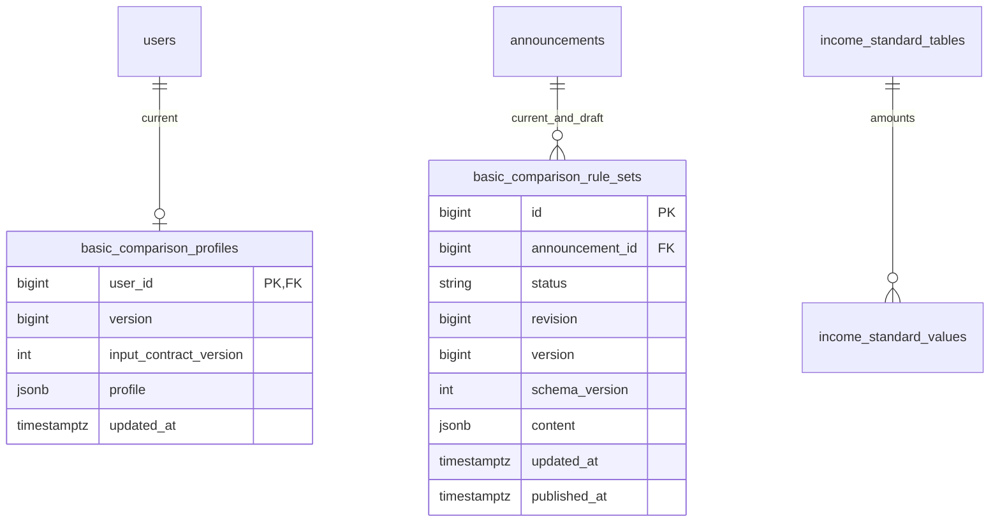

# 개인 공고의 기본 조건 비교와 직접 확인 안내

회원이 입력한 현재 본인·가족 정보와 공고의 **기본 조건**을 비교한다. 입력받지 않는 자격은
사용자가 원문에서 직접 확인할 사항으로 제공한다. 비교 단위는 **신청 단위 × 비교 경로**다.
일반 경로의 미충족을 다른 모든 경로의 신청불가로 확대하지 않으며, 공통 조건 충족도 최종 신청 가능을 뜻하지 않는다.

이 문서는 백엔드 계약이다. 화면과 알림 발송은 포함하지 않는다. 지원자 간 순위·배점·동점자·재경쟁과
당첨 가능성은 계산하지 않는다. 신청 대상 제한, 우선공급 대상 안내와 원문 접수 일정은 유지한다.

## 결과를 읽는 예시

사용자 B는 사천 거주, 1989년생, 본인 포함 2인 가족, 자녀·태아 없음으로 입력했다.
본인 소득은 월 200만원, 세대 합산 소득은 월 300만원이고, 본인 포함 가족 총자산은 1억원이다.
본인과 가족 모두 주택·차량이 없으며 혼인신고일은 2018-04-01이다.

| 사례 | 제공하는 결과 |
|---|---|
| D05 사천벌리1의 일반입주자 기본 조건 | 2인·자녀 가산 없는 사례에서 세대 소득 3,000,000원 ≤ 3,519,762원. 다른 비교 항목도 충족하면 GENERAL/MATCHED. 법정 세대 범위·제한 이력·다른 신분 경로 안내는 남음 |
| 같은 사례에서 세대 소득 3,519,763원 | 비교한 일반 경로 NOT_MATCHED와 소득 한도·입력값·근거. 다른 신분 경로까지 신청불가라고 하지 않음 |
| 선택 가족정보 생략 | 해당 항목만 INPUT_NEEDED, `optional=true`, `skipped=true`. 세대 소득 비교는 유지 |
| D11 SH 영구임대 | 서울 거주 등 공통 조건이 맞아도 COMMON_ONLY/MATCHED. 가~자목 중 하나의 별도 자격이 필수라는 안내. 가족 형태 한부모를 법정 지원대상 한부모로 간주하지 않음 |
| D03 안양 냉천 | 개인 공고에 유지하되 이미 선정된 지구 대상자만 신청할 수 있다는 필수 안내를 먼저 제공 |
| D14 다산지금A3 | 일반 경로 비교와 우선공급 대상 안내를 함께 제공. 사용자 우선 자격이나 순위는 계산하지 않음 |
| D19 기업체 기숙사 | 기업이 신청·계약하는 유형이므로 OUT_OF_SCOPE. 개인 비교 집계에서 제외 |

[D05/D11 등 재현 fixture](../../backend/src/test/java/com/toadzip/backend/basiccomparison/ComparisonFixtures.java)는
원문 일부를 사용한 테스트 자료이며 실제 공고 적재 데이터가 아니다. D06·D08·D09·D17 사례는 이번 모집의
개인/일반 경로 분류를 확인한다. 전체 공고의 모든 조건을 구현했다는 뜻은 아니다.

## 회원 API와 입력

모든 회원 경로는 `USER` 세션 인증이 필요하다. 사용자 ID는 세션에서만 얻는다.
응답은 `{"data": ...}`이며 `Cache-Control: no-store`를 붙인다. 쓰기에는 기존 CSRF 토큰이 필요하다.

| 메서드·경로 | 동작 |
|---|---|
| `GET /api/v2/eligibility/input-catalog` | 현재 입력 23개, 타입·단위·분기·선택 여부·값 종류와 설명 |
| `GET /api/v2/me/eligibility-profile` | 현재 프로필. 없으면 version 0과 UNKNOWN 값 |
| `PUT /api/v2/me/eligibility-profile` | 기대 버전을 확인하고 현재 프로필 전체 교체 |
| `GET /api/v2/announcements/{id}/basic-comparison` | 정정 체인의 최신 공고에 대한 비교·안내·근거·표시 정보 |
| `GET /api/v2/eligibility/summary` | 접수 중 최신 공고의 기본 비교·입력 부족·필수 자격 안내 건수 |

### 현재 받는 정보

| 흐름 | 입력 |
|---|---|
| 본인 | 생년월일, 거주지역, 대학생·취업준비생 여부, 주택·자동차 보유와 차량가액, 자산, 세전 월평균소득 |
| 가족·세대 | 가족 형태, 본인 포함 등본상 가족 수, 세대 합산 세전 월평균소득 |
| 미혼 | 세대분리 여부. 세대주 여부로 해석하지 않음 |
| 한부모·부부/예비부부 | 임신·자녀 여부, 태아 포함 자녀 수, 막내 생년월일 또는 출산예정일 |
| 부부/예비부부 | 혼인신고일 또는 예정일, 맞벌이 여부 |
| 선택 가족정보 | 본인 포함 가족의 주택·자동차 보유, 최고 차량가액, 총자산 |
| 부모 소득 예외 | 미혼 대학생이 세대분리했고 본인 소득이 0이라고 입력한 경우의 부모 소득 합계 |

코드·타입 원본은 [ProfileField](../../backend/src/main/java/com/toadzip/backend/basiccomparison/domain/ProfileField.java)다.
학교/근무지, 청약통장, 소득활동 이력, 우대·복지 신분, 거주기간과 계약 종료일은 현재 입력에서 제외한다.
공고에 필요하면 직접 확인 안내에 남긴다.

프로필 저장은 **전체 교체**다. 아래는 선택 가족정보를 생략한 부분 입력 예시다. 보내지 않은 사실은
UNKNOWN으로 바뀌며, 이 예시만으로 전체 기본 조건이 충족되는 것은 아니다.

```json
{
  "expectedVersion": 0,
  "inputContractVersion": 2,
  "profile": {
    "familyDetailsState": "SKIPPED",
    "facts": {
      "FAMILY_TYPE": {"state": "PROVIDED", "value": "COUPLE_OR_ENGAGED"},
      "HOUSEHOLD_MONTHLY_INCOME": {"state": "PROVIDED", "value": 3000000},
      "MARRIAGE_EVENT": {
        "state": "PROVIDED",
        "value": {"kind": "REGISTERED", "date": "2018-04-01"}
      }
    }
  }
}
```

조회 응답은 `version`, `inputContractVersion`, `updatedAt`, `profile`을 반환한다. 저장 성공 시 version이
1 증가한다. 최초 저장은 expectedVersion 0, 이후에는 조회한 현재 버전을 사용한다. 동시 수정 중 하나만
성공하며 다른 요청은 `409 BASIC_COMPARISON_CONFLICT`다. 다른 회원의 데이터와 섞지 않는다.

- 값 상태는 `PROVIDED / UNKNOWN / NOT_APPLICABLE`이다. PROVIDED에만 값이 있어야 한다.
- 가족정보 상태는 `NOT_STARTED / PROVIDED / SKIPPED`다. 생략 상태에 가족 제공 값을 함께 보내지 않는다.
- 날짜는 ISO 날짜, 금액은 음수 없는 정수 원이다. 소득은 원/월이며 본인과 세대 합계를 구분한다.
- 서비스 입력 대상은 만 19세 이상이다. 실제 생년월일·신고일은 미래일 수 없다. 공고의 연령 비교는 공고 기준일을 쓴다.
- 혼인 날짜의 종류는 `REGISTERED / PLANNED`, 막내 날짜는 `BORN / EXPECTED`다. 예정일이 지나도 실제 사건으로 바꾸지 않는다.
- 등본상 가족 수는 본인 포함·태아 제외 1~100명, 자녀 수는 태아 포함 0~100명이다. 법정 세대원 수와 같다고 추정하지 않는다.
- 자동차 없음이면 가액은 해당 없음으로 표현한다. 모르는 자산·부모 소득을 0원으로 바꾸지 않는다.
- 본인 포함 보유 정보와 최고 차량가액의 모순은 거부한다. 자산 산정 내역은 받지 않으므로 가족 총자산과 본인 자산의 대소만으로 값을 고치거나 거부하지 않는다.
- 활성 흐름 밖의 제공 값, 알 수 없는 필드·지역, 구 특수 신분과 잘못된 계약 버전·수치 타입은 400이다.

## 비교·직접 확인·표시 자료

상세 응답은 요청한 ID와 실제 최신 ID, 공개본 ID/version, 프로필 version, `availability`, `result`를 반환한다.
나이와 혼인기간의 기준일은 `result.referenceDate`다. 접속 날짜로 공고의 자격 기준일을 바꾸지 않는다.

| availability | 의미 |
|---|---|
| AVAILABLE | 새 공개 내용을 비교할 수 있음 |
| NOT_STRUCTURED | 최신 공고에 새 공개 내용이 없음. 초안·구 공개본으로 대체하지 않음 |
| NOT_PUBLISHED | 비공개 또는 관리자 삭제 공고 |
| CANCELLED | 취소된 최신 공고 |
| OUT_OF_SCOPE | 기업 신청·계약 유형. result에 제외 이유와 원문 정보 제공 |

NOT_STRUCTURED/NOT_PUBLISHED/CANCELLED에는 result가 없다. 존재하지 않는 공고는 404다.

`result.options`의 `coverage`는 GENERAL 또는 COMMON_ONLY다. 각 선택지에 단위·경로 이름, 모집 상태,
비교 상태와 문구, 항목별 `checks`, `missingInputs`, 해당 안내 ID를 제공한다.

| 비교 상태 | 해석 |
|---|---|
| MATCHED | 이 경로에서 자동 비교한 기본 조건 충족 |
| NOT_MATCHED | 이 경로에서 비교한 기본 조건 중 미충족 있음 |
| INPUT_NEEDED | 현재 받는 입력 중 비교에 필요한 값이 부족함 |
| PARTIALLY_COMPARED | 설정한 기본 조건의 적용을 확정하지 못해 직접 확인이 남음 |
| NOT_EVALUATED | 비모집·모집 여부 미확인 또는 자동 비교 항목 없음 |

명확한 미충족은 다른 입력 부족으로 숨기지 않는다. ALL에서 미충족이 있으면 미충족이고, ANY에서 충족한
대안이 있으면 다른 대안의 입력 부족이 그 결과를 막지 않는다. 복합 조건의 하위 비교값도 근거에 남긴다.
입력 밖 법정 신분을 ANY의 false 조건으로 만드는 모델은 없다.

각 `checks[].reading`은 상태, 필요한 입력, `comparedValues`를 반환한다. 소득 비교에는 입력 금액·한도·단위와
표 종류·연도·가족 수·비율이 있다. `checks[].evidenceIds`로 PDF 파일·쪽·표 위치를 찾는다.
`missingInputs`의 `optional`과 `skipped`를 사용해 생략한 가족정보를 필수 답변처럼 안내하지 않는다.

`result.directChecks`는 사용자 해당 여부를 계산하지 않는 안내다. 종류 순서대로 필수 안내부터 반환한다.

| 종류 | 안내 |
|---|---|
| REQUIRED_QUALIFICATION | D11 열거 자격, D03 사전선정 등 신청 자체에 필수인 별도 자격 |
| REQUIRED_CHECK | 법정 세대 범위, 제한 이력, 가산 적용 등 신청 전 확인할 요건 |
| OTHER_ROUTE | 비교한 일반 경로 외에 원문에서 확인할 다른 신청 경로 |
| PRIORITY_OPPORTUNITY | 우선공급 대상·원문 확인 기회 |
| PROCEDURE | 중복신청·서류·입주 전 이행·접수 절차 |

안내 대상은 공고 전체, 신청 단위, 경로 또는 그 조합이다. D11 가~자목은 문구 목록이며 자동 판정 경로가 아니다.
공고 전체에 필수 별도 자격이 있으면 GENERAL 경로로 등록할 수 없다.

원문 파일과 근거, 물리 주택형·신청 단위, 모집/예비/공가 물량, 임대조건, 접수 일정도 반환한다.
같은 공유 물량을 선택지마다 합산하지 않는다. 자격에 따라 가군/나군 임대료가 다르면 적용 설명과 후보를 함께
보여 주고 사용자 임대료를 확정하지 않는다. 순위별 접수 대상명은 원문 문구로 보존한다.

`canApply`, `eligible`, `rank`, `score`, `selectionResults`는 새 응답에 없다.

## 접속 요약

[기존 공고 검색의 접수 정책](../../backend/src/main/java/com/toadzip/backend/announcement/repository/ApplicationScheduleSql.java)을
재사용한다. 검토된 확정 일정이 있으면 원천 공고의 대략적인 날짜보다 우선한다. 조건부 접수만 있는 공고는
접수 중으로 세지 않는다. 최신 공개·미삭제 게시물만 대상으로 하고, 정정 전 게시물과 취소공고는 제외한다.
조회 묶음을 넘어도 keyset으로 모든 대상 공고를 한 번씩 처리한다.

| 필드 | 집계 |
|---|---|
| generalBasicMatchedCount | 모집 중인 GENERAL/MATCHED 선택지가 하나 이상인 개인 공고 |
| generalInputNeededCount | GENERAL/MATCHED가 없고 모집 중인 GENERAL/INPUT_NEEDED가 있는 공고 |
| requiredQualificationNoticeCount | 별도 필수 신청자격 안내가 있는 개인 공고 |
| comparedAnnouncementCount | 새 공개 내용으로 비교한 개인 공고. 기본 비교 항목이 없는 경우도 포함 |
| notStructuredCount | 접수 중 최신 공고 가운데 새 공개 내용이 없는 건수. 신청 주체도 미확인일 수 있음 |

같은 공고의 선택지가 여러 개여도 각 집계에서 한 번만 센다. COMMON_ONLY의 충족을 일반 경로 충족에 넣지 않는다.
필수 자격 안내 건수는 다른 건수와 겹칠 수 있으므로 합쳐서 전체 건수로 표시하지 않는다. 선택 입력이 부족하다는
집계도 입력을 강제하거나 입력 후 충족을 보장하는 의미가 아니다. 사용자 순위나 당일 접수 자격을 확정하지 않는다.

응답은 계산 시각·프로필 버전·비교 버전과 이 범위 설명을 함께 반환한다. 개인별 결과를 DB나 캐시에 적재하지 않는다.

## 관리자 작성과 공개

`ADMIN` 세션과 쓰기 CSRF가 필요하다. 기준 경로는
`/api/admin/announcements/{id}/basic-comparison-rule-set/draft`다.

| 작업 | 요청·결과 |
|---|---|
| GET 기준 경로 | 현재 초안. 없으면 data null |
| PUT 기준 경로 | `expectedDraftId`, `expectedRevision`, `content`로 전체 저장. 최초에는 ID null·revision 0 |
| POST `/copy` | 현재 공개 내용을 새 ID의 초안으로 복사. 이미 초안이 있으면 409 |
| POST `/validation` | `draftId`, `expectedRevision`의 초안을 공개 기준으로 검증. 성공 204 |
| POST `/publish` | 검증한 초안을 현재 공개본으로 교체 |
| GET `/api/admin/basic-comparison/income-standards` | 실제 소득표 ID·종류·연도·금액·출처 조회 |

내용의 타입 원본은 [ComparisonContent](../../backend/src/main/java/com/toadzip/backend/basiccomparison/domain/ComparisonContent.java),
조건 원본은 [BasicRule](../../backend/src/main/java/com/toadzip/backend/basiccomparison/domain/BasicRule.java)다.
현재 입력의 일치·나이·실제 날짜 경계·지역·금액·소득 상한과 제한된 ALL/ANY만 표현한다.
소득표 100% 값에 비율과 가구원수 가산을 적용하고 원 단위 HALF_UP으로 반올림한다.

작성할 때 `metadata`의 기준일, 신청 주체, 일반 경로 유무, 검토 상태, 분류 근거와 구조화한 범위를 명시한다.
`paths`는 GENERAL/COMMON_ONLY, `options`는 단위×경로다. 조건부 기본 비교에는 `appliesWhen`과
직접 확인할 `fallbackGuidanceId`를 둔다. 날짜가 예정이거나 수집하지 않는 분기의 조건은 충족으로 생략하지 않는다.

[검증기](../../backend/src/main/java/com/toadzip/backend/basiccomparison/domain/ComparisonContentValidator.java)는
같은 내용 안의 ID·참조·근거 쪽수·필수 안내 범위·금액·일정·지원 입력·소득표·지역을 확인한다.
알 수 없는 요청 속성과 제외된 선정 규칙은 거부한다. 내용은 4 MiB 이하이고 조건 트리의 깊이·항목 수도 제한한다.
구조가 유효한 REVIEWING 초안은 저장할 수 있지만 공개는 REVIEWED만 허용한다. 자동 검증이 원문 해석을 대신하지 않으므로
작성자는 비교한 범위와 제외한 요건을 정확히 설명해야 한다.

공개 시 공고의 정정 체인을 잠그고 최신 게시물·공개 상태·취소 여부와 초안 ID/revision을 확인한다.
검증 후 같은 트랜잭션에서 이전 공개본을 교체한다. 중간 DB 실패는 기존 공개본 삭제까지 롤백하고,
동시 공개는 한 요청만 성공한다. `취소공고`와 `CANCELLATION` 모두 차단한다.

## 저장 구조와 전환

현재 초안·공개 내용과 현재 프로필은 다음 두 신규 테이블에 저장한다. 결과·과거 판본·과거 프로필 테이블은 만들지 않는다.



공고×status는 유일하고 DRAFT의 version은 0, 공개 시각은 null이다. PUBLISHED의 version은 양수이며 공개 시각이 있다.
공고·회원 물리 삭제에 새 데이터는 종속 삭제된다. 내용 schema_version과 입력 input_contract_version은 2다.

공개 내용은 타입이 정해진 JSONB 집합이다. 원문·근거·단위·경로·안내·물량·가격·일정을 한 번에 교체하므로 내부 참조는
전체 내용 검증으로 지킨다. 소득 기준표 참조는 검증기가 확인한다. 물리 주택형의 기존 단지/형 ID는 선택적 표시 연결이며,
원천 행이 바뀌어도 공개 내용의 이름·면적·원문 사실을 조용히 덮어쓰지 않는다. 임의 스크립트나 동적 사용자 속성을 받지 않는다.

새 마이그레이션은
[현재 내용·프로필](../../backend/src/main/resources/db/migration/V20261106_01__basic_comparison_current_content.sql)과
[2026년 중위소득](../../backend/src/main/resources/db/migration/V20261106_02__basic_comparison_median_income.sql)이다.
실제 적용 상태를 확정하지 못한 기존 SQL 이력은 변경하지 않았다. 기존 기준표가 있으면 자연키로 보존하며 덮어쓰지 않는다.

- 구 `eligibility` 평가·선정·특수 신분·v1 회원 API·구 관리자 API 실행 코드는 제거했다. 구 경로는 404다.
- 구 `announcement_rule_sets`, `eligibility_profiles`와 관련 테이블은 보존하지만 새 API에서 읽지 않는다.
  새 공개 내용이 없으면 NOT_STRUCTURED, 새 프로필이 없으면 UNKNOWN으로 시작한다.
- 구 공개본은 원문에 맞춰 기본 비교와 직접 확인 안내를 다시 검토한 뒤 새 형식으로 공개해야 한다.
  구 프로필도 가족 범위·날짜·입력 흐름의 의미를 추측해 자동 이전하지 않는다.
- 기존 사용자 영역의 `UserEligibilityInfo`/`user_eligibility_infos`는 선행 스키마의 별도 매핑이다.
  이 기능의 새 API·저장소·평가기에서는 참조하지 않는다. 공유 스키마의 물리 정리는 이번 전환에 포함하지 않는다.

소득표 계산, 지역 포함 판정, 공고 체인 잠금, 접수 일정·인증·CSRF·공통 응답 경계를 재사용했다.
범용 27섹션 SQL 매핑, 특수 신분 자동 판정, 순위·점수·배정 계산과 구 공개본 캐시는 새 실행 경로에 남기지 않았다.

## 검증과 알려진 한계

Java·Docker 준비 후 저장소 루트에서 실행한다. 테스트 DB는 Testcontainers가 준비하며 서비스 DB를 지정하지 않는다.

```sh
cd backend
./gradlew test --tests 'com.toadzip.backend.basiccomparison.*'
./gradlew test --rerun check --build-cache
```

[API 인수 테스트](../../backend/src/test/java/com/toadzip/backend/basiccomparison/controller/ComparisonQueryIntegrationTest.java)는
실제 저장→공개→비교→요약, [프로필 테스트](../../backend/src/test/java/com/toadzip/backend/basiccomparison/controller/ComparisonProfileIntegrationTest.java)는
인증·CSRF·회원 격리·버전 경합을 확인한다. 공개 실패 롤백·정정·동시성은
[공개 테스트](../../backend/src/test/java/com/toadzip/backend/basiccomparison/controller/ComparisonManagementIntegrationTest.java),
구 경로 중단과 구 데이터 비사용은 [전환 테스트](../../backend/src/test/java/com/toadzip/backend/basiccomparison/controller/ComparisonCutoverIntegrationTest.java)에서 확인한다.
구 마이그레이션 제약 검증도 보존한다.

검토된 원문 전체를 자동 수집·구조화하는 기능은 없다. 관리자가 새 형식을 검토·공개해야 비교할 수 있다.
예시의 자녀 가산처럼 적용을 확정하지 못한 조건은 직접 확인으로 남긴다. 가족 입력과 법정 세대 범위, 공적자료 산정,
특별 자격·제한 이력의 실제 해당 여부도 자동 검증하지 않는다. 테스트 통과는 실DB 적용이나 배포 완료의 증거가 아니다.
