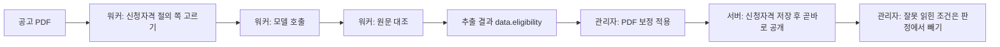

# 공고 PDF 신청자격 추출

공고문 PDF에서 신청자격을 뽑아 사용자 화면의 신청자격으로 반영하는 흐름의 설계다. 워커가 PDF에서 요건을 뽑고,
서버가 판정 조건으로 바꾸고, 관리자가 보정을 적용하면 곧바로 공개한다. 결과 형식은 [워커 계약](../../../ai-worker/contract/README.md),
초안 내용의 계약은 [공고 구조화와 공개](authoring.md)가 원본이다.

## 흐름

1. 관리자가 PDF 보정 화면에서 PDF 추출을 요청한다. 워커는 본문·공급표·신청자격 세 단계를 함께 부른다.
2. 관리자가 공급정보·일정·접수처를 확인해 보정 내용을 적용한다.
3. 적용이 끝나면 화면이 `/draft/from-extraction`을 불러, 방금 저장된 공급행과 추출 결과의 신청자격을 저장하고 곧바로 공개한다.
   보정을 다시 적용할 때마다 새로 만들어 공개본을 바꾼다. 공고가 아직 공개 전이면 저장만 하고 그 사실을 알린다
   (사용자 결정: "적용했을 때 그냥 곧바로 신청자격이 업데이트 되는 식으로 해줘").
4. 관리자가 조건을 확인하고, 잘못 읽힌 조건은 '판정에서 빼기'로 공고문에서 확인할 자격으로 옮긴다. 이것도 곧바로 공개된다.

초안을 적용 뒤에 만드는 이유는 신청 경로를 잇는 대상이 관리자가 확인한 공급행·공급대상이기 때문이다.

## 책임 나누기

| 맡는 곳 | 하는 일 | 하지 않는 일 |
|---|---|---|
| 모델 | 요건 문구를 원문 그대로 옮기고 종류·숫자·신청 경로를 표시 | 판정 조건(`ProfileRule`) 작성 |
| 워커 코드 | 쪽 고르기, 모델 응답을 원문과 대조, 금액·기준 연도 환산 | 확인하지 못한 값을 추측으로 채우기 |
| 서버 | 요건을 판정 조건으로 변환, 공급행에 경로 잇기, 작성 규칙 검증·저장 | 근거 없는 요건의 자동 판정 |
| 관리자 | 초안 확인, 직접 확인 전환, 공개 | 조건 숫자 직접 수정(이 화면 범위 밖) |

모델이 판정 조건을 직접 쓰지 않게 한 것은 숫자·연산자 오류를 코드가 잡기 어렵기 때문이다. 모델은 닫힌 요건 종류와
원문 문구만 내고, 숫자는 워커가 원문에서 다시 확인한 것만 남긴다.

## 워커

- 쪽 고르기: 신청자격·입주자격·입주자 선정 절의 쪽만 보낸다. 다른 절과 함께 적힌 짧은 제목(공급대상 및 신청자격)과
  두 단으로 모아 찍은 쪽의 오른쪽 단 제목도 절 제목으로 본다. 절 사이에 낀 3쪽 이하(소득·자산 기준표)는 함께 읽고
  제출서류 절은 뺀다. 절 제목을 찾지 못하면 본문 단계가 고른 쪽을 그대로 읽는다.
- 쪽 글: 사람이 읽는 순서로 만들고 표는 제자리에 둔다. 가로 한 장에 두 쪽을 모아 찍은 공고는 왼쪽 단을 먼저 읽는다.
- 모델 응답: 요건을 한 번씩만 쓰고 신청 경로가 ID로 가리키는 간결한 형식이다. 출력 토큰이 추출 시간을 좌우하기 때문이다.
  워커가 모든 경로에 걸린 요건은 `common`으로, 나머지는 경로별 요건으로 펼친다.
- 원문 대조: 요건 문구의 낱말이 모두 신청자격 쪽 한 곳에 있어야 근거(쪽·인용)가 붙는다. 근거가 붙지 않은 요건은 숫자를
  비우고, 서버가 판정에 쓰지 않고 목록으로만 보인다. 근거가 붙은 요건의 숫자는 원문과 맞지 않아도 그대로 두고
  '숫자 확인 필요' 경고만 남긴다. 숫자로 읽을 수 없는 값(원으로 바꾸지 못한 금액, 정하지 못한 기준 연도 등)이 하나라도
  있으면 그 요건의 숫자를 모두 비운다. 세부 규칙은 워커 계약에 있다.
- 가산 보정: 모델이 출산자녀 가산을 자산·자동차에만 달고 소득에는 빠뜨리면, 근거 쪽의 출산가구 소득 기준표 제목을 근거로
  소득에도 가산을 붙이고 경고에 쪽과 문구를 남긴다. 모델이 가산 기준표의 줄마다 요건을 따로 내면(기본 4억 1,700만원, 자녀 1명
  4억 5,900만원 …) 모두 함께 맞아야 하는 조건이 되어 가산 대상이 미충족으로 나오므로, 같은 종류·범위에서 가산 없는 요건이
  하나뿐이면 나머지 줄의 가산을 그 요건에 붙이고 따로 판정하지 않는다(탑석센트럴자이 실측).
- 실패: 신청자격 단계는 일시 오류면 한 번 다시 부른다. 그래도 실패하거나 신청자격 쪽을 읽다 시간이 모자라면
  공급·본문 결과는 그대로 두고 `data.eligibility`를 `null`로, 이유를 `warnings`에 남긴다.
- 빠진 요건: 경로가 가리킨 요건이 모델 응답에 없으면 빼지 않고 판단 보류(`UNRESOLVED`)로 남긴다. 이름 없는 경로가
  여럿이면 경로별 요건을 실을 곳이 없어 공고 전체에 판단 보류를 하나 둔다. 서버는 이 요건만 판정을 막는 직접 확인으로 둔다.
  목록으로 돌리면 남은 공통 조건만으로 지원 가능이 되기 때문이다. 선택 요건(`ANY_OF`의 하나)이 빠지면 `OTHER`로 두어
  그 `ANY_OF`를 목록으로만 보인다.

## 서버 변환

변환 규칙의 표는 [AI 추출 초안](authoring.md#ai-추출-초안)에 있다. 설계에서 지키는 원칙은 하나다.
**일반 사용자가 받은 입력으로 '한번 지원해 볼 만한지'를 알 수 있는 수준까지만 판정한다.** 세세한 자격을 모두 따지지 않고,
따지지 않은 요건은 지우지 않고 근거와 함께 목록으로 보인다(사용자 결정: "그냥 일반 사용자가 생각하는 그 수준").

- 판정에 쓰는 것은 받은 입력으로 바로 비교되는 요건(나이·무주택·소득·자산·자동차·거주지·혼인기간·가족 형태·대학생·취업준비생)이다.
- 그 밖의 요건은 판정을 막지 않는 '공고문에서 확인할 자격' 목록(조건에 연결하지 않은 `REQUIRED_CHECK`)으로만 근거와 함께 보인다.
  입력으로 판정할 수 없는 요건(청약통장, 세대원 등재, 추천 등), 원문에서 문구를 찾지 못한 요건, 판정할 종류인데 조건으로 바꾸지
  못한 요건(비워진 숫자, 없는 소득 기준표, 지역 코드로 바꾸지 못한 지역, 본인 소득)이 해당한다. 사용자 화면은 지원 가능한
  선택지에도 이 목록을 보인다.
- 출산자녀 가산은 원문의 비율(출산자녀 1인 10%, 2인 이상 20% 등)을 읽어 출산자녀 수별 높아진 기준을 계산해 판정한다.
  금액은 비율만큼 올려 만원 단위로 올림하고, 소득은 비율 %p를 더한다. 출산자녀는 막내 나이로 보며 넓게 보는 쪽이다.
- 비율을 읽지 못한 출산자녀 가산과 맞벌이 가산은 가산을 받을 수 있는 사람(자녀·임신이 있는 한부모·부부, 맞벌이 부부)을
  기본 기준을 넘어도 충족으로 본다. 알아볼 입력이 없는 가산(장애인 등)은 기본 기준으로 판정한다. 계산하지 못한 가산만 목록에 알린다.
- 요건·자격을 하나도 뽑지 못한 경로(이름이 곧 자격인 '65세 이상 직계존속 부양자' 등)는 공통 조건만으로 지원 가능이
  되지 않게 '신청 대상 …에 해당하는지' 직접 확인을 둔다.
- 공급표가 대상을 나누지 않은 공급행(대상이 없거나 `전체`뿐, 통합공공임대 등)에는 모든 경로를 잇고 검토 안내로 알린다.
  대상을 나눈 공급행에는 워커가 맞춘 대상 이름과 같은 경로만 잇는다. 워커가 대상을 맞추지 못한 경로는 나눈 공급행에
  잇지 못하므로 그 경로 이름을 검토 안내로 알린다.
- 관리자가 공급대상을 모두 뺀 공급행은 대상 구분이 없는 행으로 보지 않고 초안에서 뺀다.
- 공급대상과 이어지는 경로가 하나도 없거나, 신청자격 근거가 없거나, 작성 규칙을 통과하지 못하면 초안을 저장하지 않고
  이유를 409로 알린다. 기존 초안과 공개본은 바뀌지 않는다.

## 관리자 화면

- PDF 보정의 '신청자격' 탭과 적용 결과 화면이 같은 패널을 쓴다. 적용 결과 화면은 늘 새로 만들어 공개한다.
  패널은 초안이 있으면 초안을, 없으면 공개본을 보이고 사용자 화면에 반영됐는지 알린다. 검토 완료·공개 버튼은 두지 않는다.
- 적용 전 '신청자격' 탭은 초안이 없으면 서버 변환 미리보기(`/draft/from-extraction/preview`)를 보인다. 공통·경로별 판정 조건,
  필수 확인 자격, '공고문에서 확인할 자격' 목록, 신청 제한을 근거 쪽과 함께 읽기 전용으로 보이고 아무것도 저장하지 않는다.
  공급행이 아직 저장되지 않아 공급행 잇기는 빠진다. 미리보기를 받지 못하면 추출 결과의 신청자격을 그대로 보인다.
  초안은 저장된 공급행에 경로를 이어 만들므로 이 단계에는 만들기 버튼을 두지 않는다.
- 자동 만들기가 실패해도 보정 적용은 이미 끝난 상태다. 패널이 이유를 보이고 다시 만들 수 있게 둔다.
- 응답의 `notices`(잇지 못한 경로, 나눈 공급행에 잇지 못한 경로, 경로가 없는 공급대상, 대상 구분 없는 공급행)는 검토용이며 공개 내용에 들어가지 않는다.

## 알려진 한계

- 모델 출력은 실행마다 다르다. 같은 PDF도 경로 수와 요건 수가 달라질 수 있다. 보정을 적용하면 관리자 확인 없이
  곧바로 공개되므로, 관리자는 반영된 조건을 보고 잘못 읽힌 조건을 판정에서 뺀다.
- 보정을 다시 적용하면 '판정에서 빼기'로 옮긴 내용도 새 추출 결과로 덮인다.
- 공고를 PDF 보정 밖에서 공개하면 저장만 해 둔 신청자격은 따라 공개되지 않는다. 공고 공개 뒤 보정을 다시 적용한다.
- 비율로 계산한 가산 기준은 공고문 금액보다 조금 넓을 수 있다(만원 단위 올림).
- 거주 요건의 지역 이름(`regions`)은 원문과 대조하지 않는다. 서버가 지역 코드로 바꾸지 못하면 목록으로만 보인다.
- 모델이 어느 경로에도 잇지 않은 요건·자격은 결과에 싣지 않고 경고로만 알린다. 직접 확인으로 남기면 경로마다 걸려
  모든 경로가 판단 보류가 되기 때문이다. 관리자는 추출 경고에서 빠진 요건을 확인한다.
- 경로 요약은 공급대상 신청 조건에 합쳐지며 255자(저장 칸 길이)를 넘으면 조건 단위로 잘린다.
- 신청자격 절이 끝나는 제목을 찾지 못하면 뒤 쪽까지 읽어 보내는 쪽이 늘 수 있다.
- 본인 소득 기준은 몇 인 가구 금액인지 추출 결과에 없어 판정하지 않고 목록으로만 보인다.
- 판정을 넓힌 대가로, 목록 요건이나 가산 기준을 넘는 사람도 지원 가능으로 보일 수 있다. 목록은 신청 전에 꼭 확인할 것으로 보인다.
- 화면에서 조건 숫자를 고칠 수 없다. 잘못 읽힌 조건은 판정에서 빼거나 PDF를 다시 추출한다.
- 근거가 붙은 요건의 숫자는 원문과 맞지 않아도 판정에 쓴다. 모델이 숫자를 잘못 옮기면 '숫자 확인 필요' 경고만 남고
  판정이 틀릴 수 있어, 관리자는 경고가 붙은 조건을 근거 쪽과 맞춰 본다.
- 목록으로만 보이는 요건은 판정에 들어가지 않는다. 청약통장처럼 실제로는 신청을 막는 요건도 사용자가 목록을 읽고 확인해야 한다.

## 검증 방법

- 워커: `ai-worker`에서 `uv run pytest`. 쪽 고르기·원문 대조·단계 실패 처리를 고정 입력으로 확인한다.
- 계약: `ExtractionContractDraftTest`가 계약 예시(`result.example.json`)를 서버 해석기와 변환에 그대로 통과시킨다.
  워커가 필드 이름을 바꾸면 조건이 판정에서 빠져 목록으로 떨어지는 것을 여기서 잡는다.
- 변환: `ExtractedEligibilityDraftTest`가 만든 초안을 실제 판정기에 넣어 정한 수준(받은 입력으로 비교되는 요건만)대로 판정하는지 본다.
- 정확도와 시간은 실제 모델로 대표 PDF를 돌려 함께 잰다. 한 번의 측정은 표본이므로 프롬프트·쪽 입력·모델을 바꾸면
  같은 PDF로 다시 잰다.
