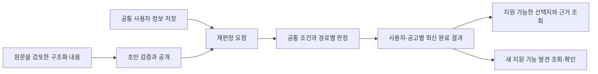

# 신청자격 판정의 범위와 연결

사용자가 공통 정보를 입력하면 공고 안의 어느 신청 단위에 어떤 신청자격으로 지원할 수 있는지와
조건별 근거를 제공한다. 서비스의 지원 가능 결과는 수집한 정보와 구조화한 조건을 비교한 결과이며
당첨·계약·입주 확정을 뜻하지 않는다. 지원자 간 선정 순위·배점·경쟁률은 계산하지 않는다.

## 전체 흐름



공고의 모든 단위와 경로를 자동으로 곱하지 않고 실제 모집 조합만 작성한다. 여러 단지·주택형을
묶어 신청하거나 여러 경로가 물량을 공유하는 관계도 보존한다. 각 계약의 원본은 다음과 같다.

| 변경하려는 내용 | 담당 문서와 경계 |
|---|---|
| 공고 조건·자격·모집 조합·공개 검증 | [공고 구조화](authoring.md). 원문 의미와 참조 검증을 함께 변경 |
| 사용자 항목·값의 의미·입력 흐름 | [공통 입력](profile.md). 카탈로그와 저장 검증을 함께 변경 |
| 지원 가능 여부·근거·처리 중 표시 | [판정과 표시](decisions.md). 조건 결과와 공고 집계·최신성을 구분 |
| 테이블·보존·작업 중단·경합 | [저장 설계](storage.md). 원자성과 오래된 작업 차단을 유지 |
| 이전 비교 소비자 | [호환 계약](compatibility.md). 최신 신청자격 판정과 혼용하지 않음 |

## 제공 범위와 후속 연결

| 영역 | 저장소에서 제공하는 기능 | 후속 연결 |
|---|---|---|
| 구조화 | 관리자 초안 저장·검증·공개, 정확한 필수 자격과 넓은 탐색 분류 저장 | 기존 수집·AI 추출 결과를 이 작성 계약으로 변환하고 원문 전체를 검토하는 흐름 |
| 입력 | 공통 입력 계약 3과 프로필·카탈로그 API, 현재 프론트 입력 연결 | 입력 의미를 전달하는 최종 도움말·첫 진입 UX |
| 판정 | 조건·경로·실제 선택지 판정과 최신 상세 화면, 직접 확인·신청 제한·근거 표시 | 원문 전체 구조화 자료 검증 |
| 갱신 | 저장과 재판정 분리·처리 상태 화면, 최신 결과·영속 요청·재시도·오래된 작업 차단 | 운영 지연·용량 검증 |
| 탐색 | 지역별 지원 가능 선택지, 불러온 목록 안의 개인 필터·범위가 명시된 건수 | 전체 공고 목록의 신청자격 필터와 정확한 집계, 특수조건 탐색 |
| 안내 | 새 지원 가능 발견의 조회·확인 API와 내 조건 관리 화면, 공고 변경 시 이전 기준 노출 차단 | 관심 조건 구독·대상 선정·별도 발송과 채널 정책 |

기존 검색·알림·AI 추출 모듈의 존재가 위 후속 연결의 완료를 뜻하지는 않는다.
현재 화면의 조회 범위와 남은 연결은 [화면과 API 연결](frontend.md)에 기록한다.
검색·관심 알림에서 지켜야 할 동작은 [연결 규칙](decisions.md#검색과-관심-알림의-연결-규칙)을 따른다.

## 아직 결정하지 않은 사항

- 결과 화면의 대표 보류 문구, 미구조화·모집 미확인 표시, 선택지·근거·신청 제한의 최종 배치.
- 지역 외 필터의 세부 결합·정렬, 전체 검색에서 재판정 중 목록을 다루는 방식, 기본 목록의 취소 공고 노출.
- 새 지원 가능 사실의 별도 알림 전달 방식, 채널별 중복 방지와 발송 시점,
  `소득조건 없음` 같은 관심 조건의 정확한 뜻, 이미 전달한 안내가 바뀌었을 때의 통지.
- 모집 예정의 제품 정책상 상세 범위, 부분 완료 결과의 표시, 마감·비활성 결과의 정리 기간.
- 동시 수정·공고 등록 부하 가정, 허용 지연, 용량·처리량 목표와 실제 100만 명 부하 검증.
- 추출·정정 수집과 이 기능의 공개 연결, 변경을 확인하고 실제 전달에 반영하는 시점.

현재 제공되는 API·입력 형식·저장 방식은 각 담당 문서의 계약이다. 위 미결 목록 때문에 이미
구현한 계약을 미확정으로 돌리거나 미결 사항을 코드의 기본값만으로 제품 정책으로 확정하지 않는다.

## 검증 범위

[사례와 fixture](decisions.md#공고-사례와-재현-fixture)는 실제 공고 일부와 가상 사용자의 조합이다.
전체 원문 적재, 현재 모집 여부 또는 서비스 DB의 실제 데이터를 증명하지 않는다.

Java·Docker를 [백엔드 실행 안내](../../../backend/README.md)에 따라 준비한 뒤 저장소 루트에서 실행한다.
통합 테스트 DB는 Testcontainers가 만들며 서비스 DB를 지정하지 않는다.

```sh
cd backend
./gradlew test --tests 'com.toadzip.backend.eligibility.*'
```

기능의 자동 검증에는 입력·인증·공개 원자성, 조건의 경계값, 지역별 선택지, 정정·취소,
오래된 작업과 중단 복구가 포함된다. 테스트 진입점은 각 담당 문서에 연결한다.
문서만 바꿀 때는 링크·요청 예제·소스 계약 대조를 수행하고 실행 동작 변경의 검증 범위는
[백엔드 테스트 기준](../../development/backend/testing.md)을 따른다.

테스트 통과, CI 통과, 서비스 DB 전환, 화면·실제 발송 확인은 서로 다른 증거다.
배포 여부는 [운영 절차](../../operations/database/eligibility-upgrade.md)에 따라 대상 환경에서 확인한다.
