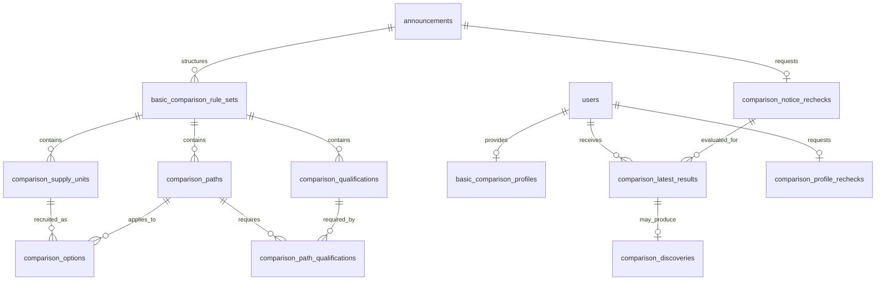

# 신청자격 판정의 데이터 모델과 갱신 경계

공고 구조·사용자 입력·최신 완료 결과의 관계, 컬럼, 제약과 동시성 규칙을 설명한다.
작성 계약은 [공고 구조화](authoring.md), 입력 의미는 [사용자 정보](profile.md),
판정·표시는 [판정 계약](decisions.md), 배포 시 적용 순서는
[DB 전환 절차](../../operations/database/eligibility-upgrade.md)를 따른다.

## 저장 경계와 선택 이유

공고 구조화 내용은 원문 근거, 조건식, 공유물량, 묶음 신청, 임대조건과 일정을 함께 검증하는
하나의 작성 단위다. 기존 `basic_comparison_rule_sets.content`의 타입이 정해진 JSONB를
원본으로 유지하고 모집 단위·경로·선택지·정확한 필수 자격은 관계형 행으로 함께 저장한다.
관계형 행은 같은 트랜잭션에서만 다시 만들며 외부에서 따로 수정하는 API를 두지 않는다.
이 투영은 DB 트리거가 아니라 저장 서비스가 수행한다. JSON만 갱신하는 writer를 혼용하면 일관성이 깨진다.

이렇게 하면 조건식의 AND/OR와 공고별 예외, 보증금·월세 조합 등의 관계를 잃지 않으면서
선택지·지역·탐색 분류에 대한 조회와 FK 검증을 할 수 있다. 조건식을 현재 사용자 입력에
맞춰 잘라 저장하지 않는다. 미수집 법정 자격도 이름·근거·원문 조건·탐색 분류를 저장한다.
새 테이블은 판정 가능한 조건만 모은 공고 축약본이 아니다.

사용자 입력은 회원별 현재 JSONB 한 벌로 저장한다. 값과 상태를 같이 검증해 교체하므로
0·없음·미입력이 섞이지 않는다. 현재 사용자 입력과 무관한 법정 자격을 프로필에 생성하지
않는다. 판정은 공고 내용과 프로필을 입력으로 받는 도메인 로직이 담당한다.

판정 결과는 회원·공고마다 최신 완료 결과 한 벌만 저장한다. 원문 문서·전체 임대조건 같은
공고 공통 데이터를 사용자 수만큼 복제하지 않고 결과에는 조건 판독·선택지 결과·근거 ID를
저장한다. 현재 공고 내용은 조회 시 연결한다. 공고 기준이 바뀌면 이전 결과의 근거를 현재
원문 근거인 것처럼 연결하지 않는다.

## 관계

DDL 원본은 [현재 내용·프로필](../../../backend/src/main/resources/db/migration/V20261106_01__basic_comparison_current_content.sql),
[관계형 공고](../../../backend/src/main/resources/db/migration/V20261106_03__comparison_application_structure.sql),
[입력 계약](../../../backend/src/main/resources/db/migration/V20261106_04__comparison_residence_profile.sql),
[최신 결과·재판정](../../../backend/src/main/resources/db/migration/V20261106_05__eligibility_latest_results_and_rechecks.sql)이다.
서비스 DB 적용 여부는 운영 환경에서 별도로 확인한다.

## 공고 구조화 테이블

### `basic_comparison_rule_sets` — 작성 단위와 현재 공개본

| 컬럼 | 타입·제약 | 의미 |
|---|---|---|
| `id` | bigint identity PK | 작성 단위의 고유 ID. 현재 공개본의 판정 기준 식별에도 사용 |
| `announcement_id` | bigint FK → announcements, 삭제 연쇄 | 원문 공고 게시물 |
| `status` | DRAFT / PUBLISHED | 공고당 각 상태 한 개, UNIQUE(announcement_id, status) |
| `revision` | bigint > 0 | 같은 초안의 수정 식별값. 기대 revision 불일치는 충돌 |
| `version` | bigint ≥ 0 | 공개 순서. 초안은 0, 공개본은 양수 |
| `schema_version` | integer, 지원하는 계약 버전 | 기존 2와 확장 3을 구분. 새 작성은 3 |
| `content` | jsonb object NOT NULL | 아래의 전체 구조화 내용. 임의 JSON을 허용하는 계약이 아님 |
| `updated_at`, `published_at` | timestamptz, 공개 시각은 공개 상태에서 필수 | 저장·공개 시점 |

공개 시 초안 검증 후 기존 공개본을 교체한다. 실패하면 이전 공개본과 관계형 행을 함께
보존한다. `version`만으로 현재성을 판단하지 않고 재사용되지 않는 `id`도 비교한다.
기존 Flyway 파일은 수정하지 않으며 새 마이그레이션으로 제약과 테이블을 추가한다.

`content` 내부 항목·적용 범위·조건 역할은 [구조화 계약](authoring.md#구조화-내용)을 따른다.
JSON 원본과 관계형 투영은 같은 작성 단위이며 따로 갱신하지 않는다.

### 관계형 공고 행

모든 행은 직접 FK 또는 단위·경로·자격의 복합 FK로 작성 단위에 종속되며 삭제 시 연쇄 삭제한다. 공개본 삭제가
사용자 최신 완료 결과까지 삭제하지 않도록 결과의 판정 기준 ID에는 이 삭제 FK를 걸지 않는다.

| 테이블 | 컬럼 | 키·제약·이유 |
|---|---|---|
| `comparison_supply_units` | rule_set_id bigint, unit_key varchar(100), label varchar(300), region_codes text[], housing_types jsonb | PK(rule_set_id, unit_key). 지역 배열 GIN 인덱스. 주택 목록은 배열이며 원문의 여러 단지·주택형 관계를 보존 |
| `comparison_paths` | rule_set_id bigint, path_key varchar(100), label varchar(300), kind varchar(30), checks jsonb | PK(rule_set_id, path_key). 조건 목록은 배열. APPLICATION은 실제 신청 경로, GENERAL·COMMON_ONLY도 이전 비교 계약의 작성·공개·읽기에 허용 |
| `comparison_qualifications` | rule_set_id bigint, qualification_key varchar(100), exact_name varchar(300), legal_basis text, conditions_as_written text, categories text[], evidence_ids jsonb | PK(rule_set_id, qualification_key). 정확한 명칭·조건·근거 필수, categories GIN. 가족 형태와 법정 자격을 동일시하지 않음 |
| `comparison_path_qualifications` | rule_set_id bigint, path_key varchar(100), qualification_key varchar(100) | 세 컬럼 PK, 경로·자격 각각 같은 rule_set의 복합 FK. 여러 대안 자격은 원문에 맞는 별도 경로로 표현 |
| `comparison_options` | rule_set_id bigint, option_key varchar(100), unit_key varchar(100), path_key varchar(100), recruitment_status varchar(30) | PK(rule_set_id, option_key), UNIQUE(rule_set_id, unit_key, path_key), 같은 rule_set 단위·경로 FK |

모집 상태는 RECRUITING, UPCOMING, NOT_RECRUITING, CANCELLED, UNKNOWN으로 구분한다.
취소는 사용자 자격 미충족이 아니다. 지역을 확인하지 못한 단위는 빈 지역 배열로 남기며
다른 단위의 위치를 복사하거나 사용자의 거주지역으로 대체하지 않는다.

관계형 행에는 조건·원문 JSON을 재해석해 별도 규칙을 만들지 않는다. 저장 직전에 타입과
참조를 검증하고 원본과 동일한 값만 투영한다. 기존 저장 내용도 새 마이그레이션에서 투영해
이전 공개본이 검색 인덱스에서 빠지지 않게 한다. 알 수 없는 구조는 공개 검증을 통과하지 못한다.

## 사용자 입력 테이블

`basic_comparison_profiles`를 회원별 현재 프로필로 계속 사용한다.

| 컬럼 | 타입·제약 | 의미 |
|---|---|---|
| user_id | bigint PK/FK → users, 삭제 연쇄 | 인증된 회원. 요청에서 타인의 ID를 선택하지 않음 |
| version | bigint > 0 | 저장 때마다 증가. 기대 version과 다르면 409 |
| input_contract_version | integer | 입력 형식을 식별. 신규 공통 입력을 포함한 지원 버전으로 저장 |
| profile | jsonb object | familyDetailsState와 항목별 PROVIDED/UNKNOWN/NOT_APPLICABLE 및 값 |
| updated_at | timestamptz NOT NULL | 현재 입력의 저장 시각 |

입력 계약은 3으로 저장하며 기존 계약 2는 읽을 수 있다. 프로필은 현재 값 한 벌만 유지한다.
값·상태·전체 교체·거주 정보의 의미는 [사용자 입력 계약](profile.md)을 따른다.

## 최신 결과와 재판정 테이블

### `comparison_latest_results` — 회원·공고의 최신 완료 결과

| 컬럼 | 타입·제약 | 의미 |
|---|---|---|
| user_id / announcement_id | bigint, 복합 PK. 사용자 / 공고 작업 기준 행 FK, 삭제 연쇄 | 정정 체인의 최초 공고 ID를 키로 사용 |
| resolved_announcement_id | bigint NOT NULL | 판정 당시 최신 정정 공고 ID. 과거 식별값이므로 공고 삭제 FK 없음 |
| profile_version / notice_generation | bigint ≥ 0 / bigint > 0 | 입력과 공고 변경 식별값. 프로필이 없으면 0 |
| rule_set_id | nullable bigint | 판정 당시 공개본 ID. 공개본 교체·삭제에 연쇄되지 않음 |
| availability / application_status | varchar(30) NOT NULL | 구조 공개 상태와 판정 당시 접수 상태 |
| evaluator_version | varchar(100) NOT NULL | 평가 로직의 버전 |
| status | varchar(30), 4개 판정 상태 CHECK | ELIGIBLE / INELIGIBLE / UNDETERMINED / NOT_EVALUATED |
| result | nullable jsonb object | 조건·경로·실제 선택지 판정. 취소·마감 등 평가 대상 밖이면 null |
| evaluated_at | timestamptz NOT NULL | 이 결과를 반영한 시각 |

`(announcement_id, user_id)` 인덱스는 취소·은퇴 공고의 기존 결과만 순서대로 정리할 때 사용한다.
공고 원문·전체 임대조건·과거 프로필은 결과에 복제하지 않는다.

### `comparison_profile_rechecks` / `comparison_notice_rechecks` — 합쳐진 재판정 요청

| 컬럼 | 타입·제약 | 의미 |
|---|---|---|
| user_id / announcement_id | 각 테이블 bigint PK/FK, 삭제 연쇄 | 회원당 또는 공고 root당 한 요청 |
| requested_version / generation | bigint ≥ 0 / bigint > 0 | 처리할 최신 입력 버전 / 공고 변경 번호 |
| cursor_announcement_id / cursor_user_id | bigint ≥ 0, 기본 0 | 마지막으로 처리한 대상. OFFSET 대신 키 순서로 이어감 |
| state | varchar(16), PENDING / RUNNING / DONE | 대기·선점·전체 순회 완료 |
| claim_token / lease_until | UUID / timestamptz | RUNNING일 때 둘 다 필수, 나머지 상태에서는 둘 다 null |
| next_attempt_at | timestamptz NOT NULL | 재시도 가능 시각. 새 요청은 즉시 처리 대상 |
| attempts / last_error_code | integer ≥ 0 / nullable varchar(100) | 연속 실패 횟수와 개인정보 없는 오류 코드 |
| updated_at | timestamptz NOT NULL | 마지막 작업 변경 시각 |
| retired | boolean NOT NULL, 공고 작업만 | 다른 정정 체인에 합쳐진 이전 root. 기존 결과를 지우는 작업으로 전환 |
| observed_basis | nullable varchar(500), 공고 작업만 | 실제 확인한 최신 게시물·공개본·공개 상태·접수 상태·평가기 버전 |

두 작업 테이블은 DONE을 제외한 `(next_attempt_at, 각 PK)` 부분 인덱스를 둔다. 공고 작업 행은
완료 뒤에도 변경 식별 기준으로 남긴다. 사용자×공고의 대기 행을 미리 만들지 않는다.
기존 회원과 최초 공고에는 마이그레이션이 요청을 생성하므로 재입력 없이 처리를 시작한다.

### `comparison_discoveries` — 아직 안내할 새 지원 가능 선택지

| 컬럼 | 타입·제약 | 의미 |
|---|---|---|
| user_id / announcement_id | 복합 PK/FK → 최신 결과, 삭제 연쇄 | 회원·공고마다 현재 발견 한 벌 |
| event_id | UUID NOT NULL | 확인 처리와 재시도의 중복 방지 식별값 |
| profile_version / notice_generation | bigint ≥ 0 / bigint > 0 | 발견이 유효한 입력·공고 기준 |
| option_ids | 비어 있지 않은 jsonb array | 새로 지원 가능해진 실제 선택지 ID |
| discovered_at / acknowledged_at | timestamptz, 확인 시각만 nullable | 발견 시점과 클라이언트의 확인 처리 시점 |

발견의 표시·확인 처리·재발견 의미는 [새 지원 가능 안내](decisions.md#저장-완료재판정-완료새-지원-가능-안내)를 따른다.
이 테이블은 현재 발견의 최소 정보이며 외부 알림 발송 이력이 아니다.

공통·경로 조건은 한 번 판독하고 선택지는 해당 판독을 참조한다. 공고 재판정의 한 묶음에서는
구조화 내용과 소득표를 한 번 읽어 재사용하고 반영 직전에는 식별값만 확인한다.
부하 검증에서는 활성 공고 수 × 사용자 수,
결과 평균 크기, 변경 빈도와 처리량을 함께 측정한다. 이 문서는 100만 명 성능의 실측 증거가 아니다.

### 갱신과 복구

현재 공고 기준은 generation과 정정 체인의 최신 게시물 ID·공개본 ID·공개 및 접수 상태·
평가기 버전을 함께 비교해 식별한다. 공개뿐 아니라 정정 연결·취소·공개 철회도 generation과
공고 재판정 필요 사실을 같은 트랜잭션에서 남긴다. 대조 작업도 두어 기존 변경 경로의 연결 누락을 감지한다.
특정 사용자의 재입력이 있어야만 변경을 반영하는 구조를 피한다.

1. 프로필 저장 트랜잭션에 현재 값·버전과 재판정 요청을 함께 기록한다.
2. 작업자는 기한이 지난 미완료 작업 또는 처리 시각이 된 작업을 잠금으로 선점한다. 긴 평가 중에는 DB 잠금을 유지하지 않는다.
3. 저장한 입력·공고 기준으로 평가한 뒤 짧은 반영 트랜잭션에서 현재 기준을 확인하고 결과·발견을 저장한다. 잠금/CAS로 이 확인과 저장을 원자화한다.
4. 기준이 다르면 결과·발견을 반영하지 않고 현재 기준의 작업을 남긴다. 늦게 끝난 작업이 최신 작업보다 우선하지 않는다.
5. 정상 완료 시 한 쌍의 결과를 교체한다. 이전 완료 결과와 비교해 새 지원 가능 발견의 최소 정보만 갱신한다.
6. 항목마다 결과 저장 뒤 커서를 기록한다. 요청 version/generation·claim token·lease가 맞을 때만 진행·완료를 갱신한다. 새 요청은 커서를 시작점으로 되돌리고 결과 저장 실패 시 커서를 진전시키지 않는다.
7. 미시작·실패·lease 만료는 재선점할 수 있다. 재시도 간격에는 상한을 두되 필요 사실을 삭제하거나 사용자 재입력을 복구 조건으로 삼지 않는다.

현재 처리 대상과 조회 시 최신성은 [판정 API](decisions.md#단건-조회)를 따른다.
worker 설정·중단 복구·관측 절차는 [운영 문서](../../operations/database/eligibility-upgrade.md#재판정-처리와-관측)를 따른다.

### 최신 결과 구현의 잠금 경계

정정 체인의 최초 공고 ID를 안정적인 결과 키로 사용한다. `comparison_notice_rechecks`는
이 키의 generation anchor로 계속 남기고 최신 결과의 공고 FK는 이 anchor를 참조한다.
announcements를 결과에서 직접 참조하면 결과 INSERT의 FK 검사 잠금과 기존 공고 writer의
잠금 순서가 뒤집힐 수 있다. 삭제 관계는 공고 → anchor → 최신 결과 → 발견으로 연결한다.

공고 관련 DB 트리거는 공개/취소/정정 연결/관리자 삭제/접수 날짜·검증 일정과 공개 구조 변경을
같은 트랜잭션에서 작업에 남긴다. 조회수 증가는 제외한다. 정정으로 독립 공고가 다른 root에
합쳐지면 이전 root는 은퇴시키고 새 root로만 반영·조회한다. 두 root 갱신은 ID 순으로 한다.

worker는 선점 트랜잭션을 끝내고 읽기 스냅샷으로 계산한다. 반영 시 user → 해당 profile job →
notice anchor 순으로 짧게 잠그며 공고 행을 다시 잠그지 않는다. 현재 profile/version, canonical
root, generation, 공개본, 모집 상태와 claim token/lease가 맞을 때만 결과·발견을 교체한다.
커서는 결과 저장 뒤 같은 요청·claim에 대한 CAS로 갱신한다. 같은 기준의 재시도는 no-op이며
발견 식별값과 사용자 확인 상태를 보존한다.

공고 내용에서 참조 중인 소득 기준표의 같은 ID는 불변으로 다룬다. 금액 변경·삭제·행 이동은
DB에서 거부한다. 초안·공개본의 참조 저장은 해당 기준표 부모 행에 SHARE 잠금을 ID 순으로
획득하고 기준표·금액 변경은 같은 부모 행에 UPDATE 잠금을 얻은 뒤 참조를 확인한다.
최초 참조 생성과 기준표 수정이 동시에 시작돼도 과거 기준값으로 판정한 결과가 현재로 남지 않는다.
종류·연도의 유일 제약은 조회 인덱스로 바꿔 같은 연도의 정정표를 새 ID로
추가할 수 있게 했다. 정정표를 참조하는 새 구조를 공개해 재판정한다. 공고 날짜 경과와
평가기 변경은 작은 묶음의 대조 작업으로 감지하며
같은 기준을 반복 확인한 것만으로 진행 중 커서·claim을 초기화하지 않는다.

## 코드와 검증 진입점

[구조 저장 서비스](../../../backend/src/main/java/com/toadzip/backend/eligibility/service/EligibilityRuleSetService.java)는
작성 단위 검증과 JSON·관계형 투영의 트랜잭션을 소유한다.
[재판정 서비스](../../../backend/src/main/java/com/toadzip/backend/eligibility/service/EligibilityRecheckWorker.java)는
작업 순회와 평가·반영의 경계를 연결한다. 테이블을 추가하거나 잠금 순서를 바꿀 때 이 두 경계를 함께 검토한다.

[구조 저장 테스트](../../../backend/src/test/java/com/toadzip/backend/eligibility/controller/EligibilityStructureStorageIntegrationTest.java)는
투영·복합 FK·중복 조합을,
[재판정 동시성 테스트](../../../backend/src/test/java/com/toadzip/backend/eligibility/controller/EligibilityRecheckConcurrencyTest.java)와
[무결성 테스트](../../../backend/src/test/java/com/toadzip/backend/eligibility/controller/EligibilityRecheckIntegrityTest.java)는
오래된 작업·정정 연결·소득 기준표 변경 경합을 다룬다. 실행 조건은 [검증 안내](overview.md#검증-범위)를 따른다.
